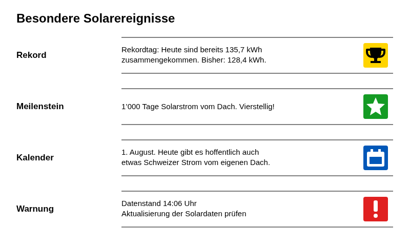

# Ereignis-Badges auf dem E1002

Die Vergleichstafel zeigt die vier Symbole in ihrer Anzeigegrösse von 48 × 48 Pixeln. Jede Einzelansicht verwendet die Dashboard-Vorlage und die Beispieldaten des Renderers.



| Vorschau | SVG fürs Panel | Browseraufnahme bei 800 × 480 |
| --- | --- | --- |
| Vergleichstafel | [SVG](previews/badge-preview.svg) | [PNG](screenshots/badge-preview.png) |
| Gewöhnlicher Insight | [SVG](previews/preview-default.svg) | [PNG](screenshots/preview-default.png) |
| Tagesrekord | [SVG](previews/preview-record.svg) | [PNG](screenshots/preview-record.png) |
| 1’000 Betriebstage | [SVG](previews/preview-milestone.svg) | [PNG](screenshots/preview-milestone.png) |
| Schweizer Bundesfeiertag | [SVG](previews/preview-calendar.svg) | [PNG](screenshots/preview-calendar.png) |
| Veraltete Messwerte | [SVG](previews/preview-warning.svg) | [PNG](screenshots/preview-warning.png) |

## Temporär auf dem E1002 ansehen

1. Auf einem Rechner im selben Netz die Vorschaudateien bereitstellen. Im Repository-Stamm erzeugen diese Befehle sechs SVGs in einem separaten Verzeichnis und starten dafür einen temporären HTTP-Server.

   ```sh
   python -m renderer.preview_badges
   python -m http.server 8765 --directory renderer/output/badge-previews
   ```

2. Die bisherige Dashboard-URL des Geräts notieren. Im vorhandenen Anzeigeprofil eine temporäre Seite öffnen oder dessen Bildquelle vorübergehend auf `http://<LAN-IP-des-Rechners>:8765/badge-preview.svg` setzen. Über denselben Pfad sind die fünf Dateien `preview-*.svg` einzeln abrufbar. Für ein Profil mit Rasterbild-Import die verlinkten 800 × 480 PNGs als Testbilder in Originalgrösse öffnen.
3. Nach einer vollständigen Panelaktualisierung die vier Symbole, ihre Farben und die zweizeiligen Texte aus dem üblichen Betrachtungsabstand prüfen. Besonders auf die Pokalhenkel, Kalenderbügel und den einzelnen Punkt unter dem Warnstrich achten.
4. Am Gerät die bisherige Dashboard-URL wieder öffnen und den Vorschau-Server mit Strg+C beenden. Der reguläre Publisher läuft während der Prüfung weiter.

## Validierung

- `python -m unittest discover -s tests -v` bestand mit 226 Tests, davon 16 Node-gestützte JavaScript-Tests. Es gab keine übersprungenen Tests. Der Publisher-Smoke-Test prüfte SVG, JSON und die Nginx-Routen.
- Chromium renderte alle sechs Vorschauen bei 800 × 480 und einem Gerätepixel pro CSS-Pixel. Die vier Badges auf den Einzelansichten lagen bei (727, 336) und massen jeweils 48 × 48 Pixel. Das normale Beispiel-SVG war bytegleich mit dem Renderer auf dem Ausgangsstand `87d7755`.
- Alle 76 Vorlagenvarianten für Meilensteine, Kalender und den morgendlichen Rekordrückblick passten mit den geprüften dynamischen Werten bei 15 px. Die breiteste gemessene Zeile hatte 417,8 px, der kleinste Abstand zum Badge betrug 54,2 px. Ein Regressionstest erzwingt mit langen Wörtern auch die Stufen 14 px und 13 px sowie die Rückkehr zur ursprünglichen Darstellung mit vollständigem Text.
- Bei einem veralteten Messwert bleibt die Statusanweisung auf einer eigenen Zeile. Fehlen die Solardaten vollständig, behält der Publisher das letzte gültige SVG bei.
- Die Sichtprüfung erfolgte in Chromium. Farbkontrast unter Umgebungslicht, Ghosting nach einem Bildwechsel und die Erkennbarkeit aus der Entfernung müssen auf einem physischen E1002 geprüft werden.
